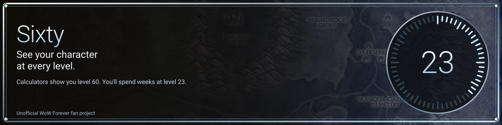
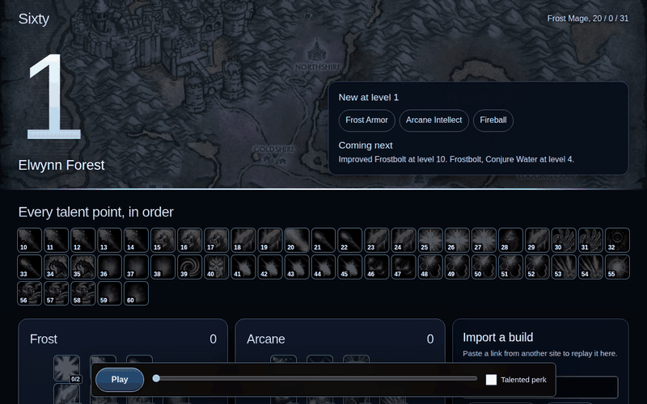
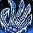
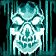
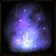
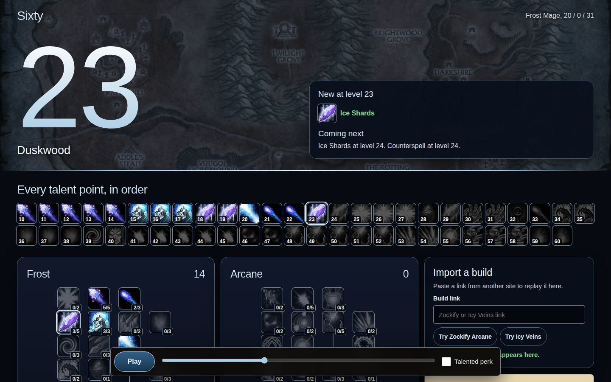
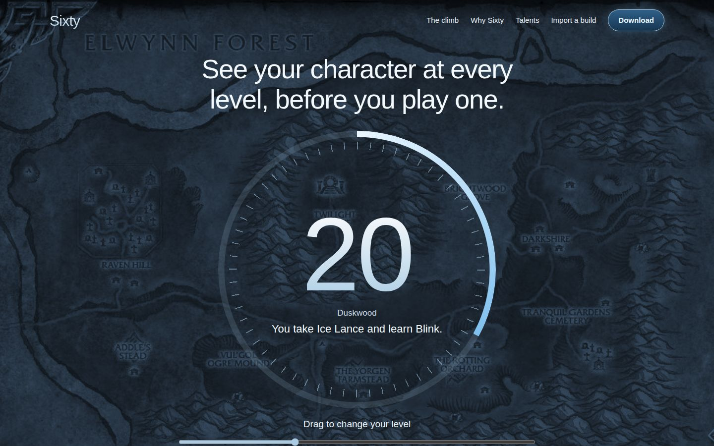

  
  
  
  

<a href="https://sixtywow.xyz"><b>Website</b></a> &nbsp;|&nbsp; <a href="https://sixtywow.xyz/downloads/Sixty-setup.exe"><b>Download for Windows</b></a>

<h1 align="center">Calculators show you level 60. You'll spend weeks at level 23.</h1>

Drag one slider and your WoW Forever character changes with it: talents, spells and the zone you should be in. Press play and watch the whole climb in about half a minute. Stop on any level you care about.

## One build, six moments

This is the Frost Mage Leveling Build, 20 / 0 / 31, as Sixty plays it.

| Level | Talent | What changes |
|---:|---|---|
| **10** |  Improved Frostbolt | Your first point speeds up your main spell. |
| **20** |  Ice Lance | Your first real burst button arrives, and Blink comes with it. |
| **25** |  Shatter | Frozen targets take critical strikes far more often. |
| **30** |  Fingers of Frost | Your Chill effects start setting up free Frozen hits. |
| **40** |  Ice Barrier | The Frost tree is finished, and points move to Arcane. |
| **60** |  Improved Counterspell | The 51st point is spent, and the build is complete. |

## What's on screen

- **New at this level.** Everything you just unlocked, right next to the level number.
- **Coming next.** The next talent and the next spell, so you always know why you're pushing on.
- **Every point, in order.** All 51 talent points in one row. Click any of them to jump to that level.
- **The Talented perk.** Turn on this Legacy perk to see talents arrive earlier. The numbers come from a beta guide, so check them at launch.
- **A spellbook that grows.** Spell data currently stops at level 40.

## Replay a build from another site

| Link format | What happens today |
|---|---|
| Talent calculator links | Mage links convert and replay |
| Export strings and build codes | Two known Mage builds load and replay |
| Forum and guide links | Recognizes the link, with no conversion yet |

## See the rest

<table>
  <tr>
    <td></td>
    <td></td>
  </tr>
</table>

## FAQ

<b>Isn't this just a talent calculator?</b>

 
A calculator answers "what does the finished build look like?" Sixty answers "what do I have right now, and what's next?"

<b>Can I download it today?</b>

 
Yes. The Windows build is a single `Sixty-setup.exe`, linked at the top of this page and in [releases](../../releases/latest). No account, no installer.

<b>Are these zones the best route?</b>

 
They're an example route picked by each zone's minimum level. The talent order is real, and the zones are there to show the idea.

<b>Is this made by Blizzard?</b>

 
No. Sixty is an unofficial fan project. Blizzard didn't make it and doesn't endorse it.

<b>A talent looks wrong. What should I do?</b>

 
<a href="../../issues">Open an issue</a> with the level, the talent and where you saw the correct value.

## Credits

The default build comes from the WoW Forever Builds library, kept current for WoW Forever Season 1.

## License and rights

Sixty is a free, non-commercial, unofficial fan project. It isn't affiliated with or endorsed by Blizzard Entertainment.

World of Warcraft and Blizzard Entertainment are trademarks or registered trademarks of Blizzard Entertainment, Inc. All game assets and all rights to them belong to Blizzard Entertainment, Inc. Read [LICENSE-ASSETS.md](LICENSE-ASSETS.md) for details.

The project's own code and design are released under MIT.
